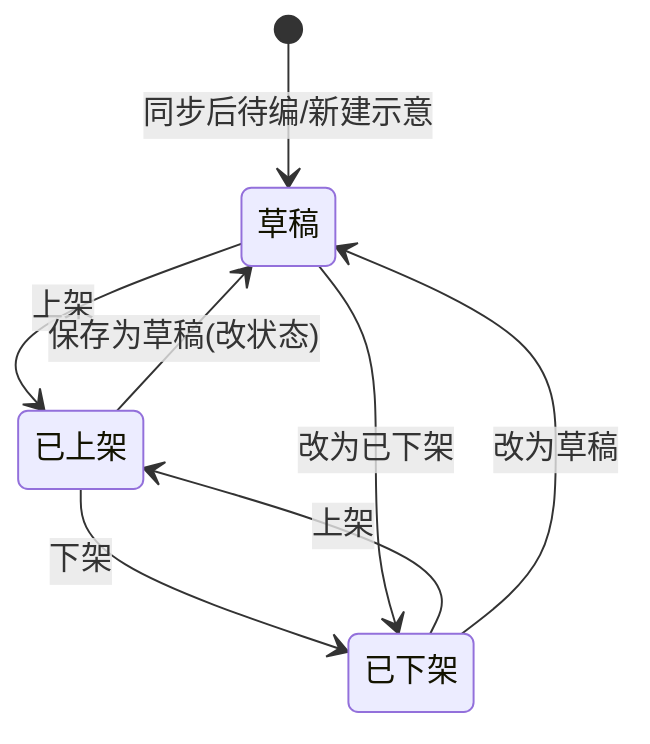

# BPS Catalog 产品需求文档（PRD）

| 项 | 内容 |
|---|---|
| 文档版本 | v0.1 |
| 日期 | 2026-07-24 |
| 状态 | 评审稿 |
| 适用系统 | 前台客户端（bps-catalog-v0.1）；后台 BPS Catalog 管理端（商品库 / 资源位 / 分类） |
| 读者 | 研发、测试、产品评审 |
| 说明 | 接口路径与字段名为【草案】，最终命名由研发定稿；示意字段已标注。除「接口说明」「数据来源标签」外，正文业务描述一律中文。 |

---

## 1. 背景与问题

商品目录需要运营可配置的商品展示、分类与首页资源位能力，并与客户端前台联动：

- 商品展示信息与产品库主数据分离：产品库同步进商品库后，运营在本端配置面向客户的展示内容与上架状态。
- 首页横幅与商品流由后台资源位配置驱动，前台按资源位顺序渲染。
- 集合落地页通过「集合键」打开，与资源位编号解耦，便于曝光归因与复用。
- 分类中英双名：后台维护；前台展示英文名；一级分类可配置图标。

当前前后台均有可交互原型，本需求文档将能力写成可评审、可开发的说明；**一期裁剪在文末统一标注，正文先写全量功能。**

---

## 2. 目标与成功指标

### 2.1 必须达成

- 前台可基于后端数据完成：分类浏览、首页资源位、集合落地、商品列表/搜索、商品详情（不含加购结算）。
- 后台可完成：商品库三态运营、展示配置、资源位（商品流 / 横幅）配置、分类树与一级图标管理。
- 商品状态变更后，前台刷新即可体现可见性变化（由服务端决定是否下发；前台不按状态过滤）。
- 文档约定清晰：每模块含说明、交互、接口【草案】、数据来源标签。

### 2.2 期望

- 前后端接口命名与路径在评审后收敛为统一契约。
- 产品库同步机制、运费业务规则、币种换算规则在待确认关闭后补齐。

---

## 3. 用户与场景

| 角色 | 场景 |
|---|---|
| 终端用户（前台） | 浏览分类与首页运营位，进入集合或商品详情，按条件筛选商品，查看运费时效示意 |
| 运营（后台） | 维护商品展示与上下架/草稿；配置资源位与集合；维护三级分类与一级图标 |

本期需求文档**不写**角色权限矩阵。

---

## 4. 边界与非目标

**本期相关、写入本文：**

- 前台商品目录浏览链路（见功能清单）。
- 后台商品库 / 资源位 / 分类。

**明确非目标：**

- 加购、购物车、结算、支付、订单。
- 其它壳层业务系统（后台壳层仅视觉参考，无业务需求）。
- 独立「集合」管理模块（集合配置挂在资源位上，不设独立后台菜单）。

**规则类、正文待补充：**

- 运费与时效业务规则（计算口径、偏远附加等）。
- 产品库 → 商品库同步机制。
- 币种切换/换算（已有能力，规则待确认）。

---

## 5. 功能清单（开发先看）

> 数据来源标签：【后端接口】 / 【前端写死】 / 【待确认】 / 【待补充】  
> 「一期是否做」列：全文写完后统一回填；当前默认留空供评审勾选。

### 5.1 前台功能清单

| 模块 | 功能要点 | 数据来源 | 一期是否做 |
|---|---|---|---|
| 首页-分类 | 三级分类菜单；一级展示图标；点击三级进入全部商品并带分类条件 | 【后端接口】 | |
| 首页-横幅 | 轮播；按内容类型点击（纯图 / 图+链接 / 商品流）。规则分两条：①资源位停用则不下发、前台不展示该资源位；②顶部横幅区加载失败或无可用横幅内容时展示不可点击占位图（需设计） | 【后端接口】；展示顺序=后台资源位顺序；占位图【待设计】 | |
| 首页-商品流区块 | 标题/副标题/商品卡；进集合或详情 | 【后端接口】；展示顺序=后台资源位顺序 | |
| 集合落地页 | 按集合键展示头图/标题/副标题/商品列表；空态 | 【后端接口】 | |
| 全部商品（含搜索） | 关键词、分类、发货地、价格/库存等筛选；排序；分页；仅已上架 | 【后端接口】 | |
| 商品详情 | 图集、规格、展示价/库存、标签、材质、富文本、运费时效；无加购 | 【后端接口】；运费规则【待补充】 | |
| （规则类）币种切换 | 顶栏等已有入口能力 | 【待确认】 | |
| （规则类）运费与时效 | 全局规则 | 【待补充】 | |

### 5.2 后台功能清单

| 模块 | 功能要点 | 数据来源 | 一期是否做 |
|---|---|---|---|
| 商品库-列表 | 三态页签；筛选对齐原型；多选后批量；删除校验资源位引用 | 【后端接口】 | |
| 商品库-编辑 | 必填：标题/主图/展示价库存/三级分类；运费可空；状态+保存 | 【后端接口】 | |
| 资源位-列表 | 名称必填唯一；启停二次确认；顺序影响下发 | 【后端接口】 | |
| 资源位-编辑 | 横幅/商品流配置与保存前置校验；选品仅已上架；上下移 | 【后端接口】 | |
| 分类管理 | 同级中英唯一；一级图标必填；引用则禁删；级联确认 | 【后端接口】 | |
| （规则类）产品库同步 | 商品主数据来自产品库，本端只配展示 | 【待确认】 | |
| （规则类）运费规则 | 与前台运费展示对应 | 【待补充】 | |

---

## 6. 前台模块详述

> 前台工程为客户端原型工程。壳层（顶栏/侧栏导航结构）**不作为本期需求模块**，仅作为页面承载。  
> **前台渲染原则：** 页面展示什么内容，以服务端接口下发为准，前台不按商品状态、资源位状态自行过滤或拼装。后端对前台只下发已上架商品及生效中的资源位内容；停用资源位、非已上架商品均不会出现在前台接口结果中。

---

### 6.1 首页-分类

#### 功能说明

用户在首页通过三级分类菜单浏览类目；一级分类展示后台配置的图标；选中三级分类后进入「全部商品」并带上分类筛选条件。前台展示分类名称以**英文名**为准。

#### 原型截图

**【在此粘贴原型截图 · 图 首页-分类-主界面】**

**【在此粘贴原型截图 · 图 首页-分类-展开态（按需）】**

#### 交互说明

1. 悬停（或点击）打开分类面板，展示一级列表；一级项展示图标（无图标时前端占位图）。
2. 选择一级后展开二级；选择二级后展开三级。
3. **仅点击三级分类**跳转「全部商品」，并携带一/二/三级分类条件（传英文名还是分类编号【待确认】；推荐与后台编号对齐，展示仍用英文名）。
4. 一级、二级仅用于展开，不直接跳转列表。
5. 加载失败：面板内错误提示并可重试；空树：提示暂无分类。

#### 接口说明【草案】

- **获取分类树**
  - 方法/路径草案：`GET /api/catalog/categories/tree`
  - 用途：首页分类菜单、全部商品分类筛选
  - 关键出参（示意）：
    - `id` string
    - `nameCn` string（前台可不展示）
    - `nameEn` string（前台展示）
    - `iconUrl` string | null（仅一级有意义）
    - `children` 递归同结构
  - 主要错误：`500` 服务异常；空数据返回 `[]`
  - 鉴权：前台只读，【待确认】是否需登录

#### 数据来源

【后端接口】（原型中的本地分类树仅为示意）

#### 验收要点

- 前置：后台已配置三级分类与一级图标。操作：打开首页分类。预期：可见英文名与一级图标。
- 前置：用户点击某三级分类。操作：进入全部商品。预期：列表按该分类过滤。
- 前置：某商品已改为非已上架（后台操作后）。操作：前台刷新并在该分类下浏览。预期：接口不再返回该商品，列表中不出现。

---

### 6.2 首页-横幅

#### 功能说明

首页展示类型为「横幅」的资源位内容：多图轮播。每一张幻灯片必有图片，并具备一种内容形态：

| 内容类型 | 含义 | 点击行为 |
|---|---|---|
| 纯图 | 仅展示图片 | 不可跳转 |
| 图+链接 | 图片绑定跳转地址 | 跳转所配链接（外链或站内，按链接本身） |
| 商品流 | 图片关联一组商品与集合 | 进入集合落地页（按集合键） |

多个横幅/商品流资源位在首页的**展示顺序 = 后台资源位顺序**。前台只渲染接口下发的资源位列表（服务端仅下发生效中的资源位）。

#### 原型截图

**【在此粘贴原型截图 · 图 首页-横幅-主界面】**

**【在此粘贴原型截图 · 图 首页-横幅-默认占位图（需设计）】**

#### 交互说明

1. 自动轮播；支持手动切换上一张/下一张（若原型有）。
2. 点击热区按上表行为；纯图点击无跳转。
3. 内容类型为商品流时：点击进入集合落地；商品列表以接口下发为准（后端只下发已上架商品）。
4. **规则一（资源位启停，与占位图无关）：** 某资源位在后台停用后，服务端不再下发该资源位，前台**不再展示**该资源位（横幅、商品流均如此）。
5. **规则二（顶部横幅区占位，独立规则）：** 首页顶部横幅区域在「接口加载失败」或「无可用横幅内容可展示」（例如全部横幅资源位均已停用导致下发为空）时，**仍保留顶部横幅展示位**，显示**默认占位图**；占位图**不可点击**、不跳转。占位图视觉稿【待设计】，定稿前可用灰色示意底图。  
   > 说明：规则一处理的是「某个资源位还展不展示」；规则二处理的是「顶部横幅这一固定区域没内容/失败时怎么兜底」。二者分开，不要混写。

#### 接口说明【草案】

- **获取首页资源位列表**（横幅与商品流可同一接口，按下发顺序返回）
  - 方法/路径草案：`GET /api/catalog/home/slots`
  - 关键查询：无；或 `position=home`【示意】
  - 关键出参（示意）：
    - `slots[]`：按 `homeOrder` / 排序字段升序；**仅含生效中资源位**
    - 每项：`slotId`、`type`=`banner`|`feed`、展示字段、`items[]`
    - 商品相关数据中的商品均为已上架（由服务端保证）
    - Banner item：`adImage`、`bannerContent`、`adLink?`、`collectionKey?`、`productIds?`（或直接嵌商品摘要）
  - 错误：`500`；无数据 `slots: []`（前台顶部横幅区走占位图规则）

> 说明：具体拆成「首页聚合接口」还是「分类/资源位/商品多接口」由研发定；需求要求前台最终拿到的业务数据完整覆盖上表能力。前台按返回结果渲染，不根据状态字段自行决定显隐。

#### 数据来源

【后端接口】

#### 验收要点

- 前置：后台配置三张横幅分别为纯图、图+链接、商品流且生效。操作：前台分别点击。预期：行为符合上表。
- 前置：调整资源位顺序。操作：前台刷新。预期：区块顺序与下发顺序一致。
- 前置：商品改为草稿后。操作：刷新首页横幅商品流或集合。预期：接口不再返回该商品，前台不出现。
- 前置：停用某一横幅资源位（仍有其它生效横幅）。操作：前台刷新。预期：该资源位不再出现在下发与页面中；其它横幅正常展示。
- 前置：顶部横幅接口加载失败，或下发无任何可用横幅内容。操作：打开首页。预期：顶部横幅区显示默认占位图，点击无跳转。

---

### 6.3 首页-商品流区块

#### 功能说明

展示类型为「商品流」的资源位：面向客户的标题、副标题、商品卡片列表；可从标题/「更多」进入集合落地页；点击商品卡进入商品详情。

#### 原型截图

**【在此粘贴原型截图 · 图 首页-商品流-主界面】**

#### 交互说明

1. 按接口下发顺序渲染一个或多个商品流区块（仅下发生效中的资源位）。
2. 商品卡展示主图、标题、展示价、标签等（以后端返回的商品摘要为准；后端只下发已上架商品）。
3. 点击商品进入商品详情；点击「更多」或区块标题进入集合落地（按集合键）。
4. 若某商品流下发的商品列表为空：区块隐藏或显示空态【待确认，默认隐藏空区块】。
5. **资源位停用：** 服务端不再下发该资源位，前台不再展示（不适用顶部横幅占位图规则）。

#### 接口说明【草案】

- 复用 `GET /api/catalog/home/slots` 中 `type=feed` 项；或
- **获取商品流详情**：`GET /api/catalog/slots/{slotId}`【草案】
- Feed 关键字段（示意）：`title`、`description`、`collectionKey`、`products[]`（服务端仅含已上架商品）

#### 数据来源

【后端接口】

#### 验收要点

- 前置：商品流已配置商品与集合且生效。操作：点击更多。预期：进入对应集合键的落地页。
- 前置：某商品被改为草稿。操作：刷新首页。预期：接口不再返回该商品，该卡从商品流消失。
- 前置：停用该商品流资源位。操作：前台刷新。预期：该区块不再出现。

---

### 6.4 集合落地页

#### 功能说明

独立落地页，通过**集合键**访问（与资源位编号分离）。展示集合头图、标题、副标题及商品列表。集合配置来源于资源位（商品流级，或横幅某张「商品流」幻灯片级）。

> 访问路径最终由研发确定；业务上必须以集合键定位，不得用资源位编号代替。

#### 原型截图

**【在此粘贴原型截图 · 图 集合落地页-主界面】**

**【在此粘贴原型截图 · 图 集合落地页-空态（按需）】**

#### 交互说明

1. 进入页面请求集合详情；成功则渲染头图与商品列表。
2. 点击商品进入详情。
3. 集合键不存在：展示不存在提示。
4. 存在但接口返回商品列表为空：空态文案（如暂无商品）。
5. 商品列表以下发为准（后端只下发已上架商品）。

#### 接口说明【草案】

- **获取集合落地详情**
  - 方法/路径草案：`GET /api/catalog/collections/{collectionKey}`
  - 关键出参（示意）：
    - `collectionKey`、`title`、`subtitle`、`headerImage`
    - `products[]`：商品摘要（仅 listed）
  - 错误：`404` key 不存在；`500` 服务异常

#### 数据来源

【后端接口】（接口名/路径开发可调整，业务键必须是集合键对应字段）

#### 验收要点

- 前置：后台为某商品流生成集合键。操作：前台用该集合键打开落地页。预期：标题、头图、商品与后台配置一致。
- 前置：排查曝光归因。操作：核对落地标识。预期：使用集合键，而不是资源位编号。

---

### 6.5 全部商品（含搜索）

#### 功能说明

商品浏览与筛选中心；支持关键词搜索（原独立搜索并入本模块）、分类、发货地、价格区间、库存条件、排序与分页。列表数据由接口返回；**服务端只下发已上架商品**，前台不做状态过滤。

#### 原型截图

**【在此粘贴原型截图 · 图 全部商品-主界面】**

**【在此粘贴原型截图 · 图 全部商品-筛选区（按需）】**

#### 交互说明

1. 从首页三级分类、顶栏搜索、首页入口等进入，可携带关键词或分类条件。
2. 筛选（与现有前台原型对齐，条件可调，标示意）：
   - 关键词：匹配标题、货号、描述等【示意】
   - 分类：一/二/三级（展示英文名）
   - 发货地
   - 价格区间
   - 库存预设或自定义区间
   - 排序：最新上架、价格升序、价格降序、库存【示意】
   - 分页：每页条数示意 20 / 50 / 100
3. 点击商品卡进入详情。
4. 无结果：空态；接口失败：错误态并可重试。

#### 接口说明【草案】

- **商品分页查询**
  - 方法/路径草案：`GET /api/catalog/products`
  - 关键查询（示意）：
    - `q`、`categoryL1`、`categoryL2`、`categoryL3`（或 `categoryId`）
    - `shipFrom`、`priceMin`、`priceMax`、`inventoryMin`、`inventoryMax`
    - `sort`、`page`、`pageSize`
    - 服务端强制 `status=listed`（或等价）
  - 关键出参（示意）：`total`、`list[]`（`id`、`title`、`mainImage`、`displayPriceUsd`、`tags`、`shipFrom`、`categoryPath`…）
  - 错误：参数非法 `400`；`500`

#### 数据来源

【后端接口】

#### 验收要点

- 前置：存在草稿商品。操作：打开全部商品列表。预期：草稿不出现。
- 前置：用货号关键词搜索。操作：查询。预期：仅命中已上架商品。
- 前置：从三级分类带入条件。操作：打开本页。预期：筛选条件已选中且结果匹配。

---

### 6.6 商品详情

#### 功能说明

展示单个已上架商品的完整面向客户信息：主图/图集、标题、描述、材质、标签、规格切换（影响价格/库存/规格图）、富文本详情、按收货国家查看运费与时效。**不含加购/结算。**

若商品非已上架（或编号无效）：不可访问，或展示下架/不存在态。

#### 原型截图

**【在此粘贴原型截图 · 图 商品详情-主界面】**

**【在此粘贴原型截图 · 图 商品详情-运费区（按需）】**

#### 交互说明

1. 切换规格：更新展示价、库存、规格图。
2. 切换收货国家：请求或切换该国运费时效（运输方式、处理时效、配送时效、费用、备注）。
3. 运费业务规则（计费口径等）：【待补充】；接口仍需返回可展示内容。
4. 无加购按钮需求。

#### 接口说明【草案】

- **商品详情**
  - 方法/路径草案：`GET /api/catalog/products/{productId}`
  - 关键出参（示意）：展示字段、`gallery`、`specs[]`、`tags`、`detailCopy`、`material`、`categoryPath`、`shipFrom`、`status`
  - 错误：`404` 不存在或不可见；`500`
- **商品运费时效**
  - 方法/路径草案：`GET /api/catalog/products/{productId}/shipping?country=US`
  - 关键出参（示意）：`country`、`cost`、`method`、`processing`、`delivery`、`note`
  - 亦可合并进详情的 `shipping[]`【草案二选一，研发定】
  - 错误：国家不支持 `400`；`404`

#### 数据来源

【后端接口】；运费规则正文【待补充】

#### 验收要点

- 前置：已上架商品。操作：打开详情并切换规格。预期：价格、库存、规格图一致变化。
- 前置：商品改为草稿后。操作：再次访问详情。预期：不可见，或不存在/下架态。
- 前置：切换收货国家。操作：查看运费区。预期：内容来自接口。

---

### 6.7 （规则类）币种切换

#### 功能说明

前台已有币种切换入口。换算规则、汇率来源、是否影响下单（本期无下单）均【待确认】。

#### 原型截图

**【在此粘贴原型截图 · 图 币种切换（按需）】**

#### 交互说明

【待确认】确认前：本文仅保留入口存在性；不写死换算公式。

#### 接口说明【草案】

【待确认】是否需要汇率接口，或纯前端写死汇率表。

#### 数据来源

【待确认】

---

## 7. 后台模块详述

> 后台工程：BPS Catalog 管理端。菜单：商品库、资源位、分类。  
> 本章按 B 端规范撰写：每个模块含功能说明、入口、页面状态、信息架构、**功能点操作表**（前置/后置校验）、状态说明、校验汇总、截图空位、接口【草案】、验收要点。  
> 操作表中的「调用」仅写中文能力名；英文字段与路径见各模块接口节及第 9 章。

---

### 7.1 商品库-列表

#### 功能说明

运营按状态查看、筛选、批量处理与单行操作商品。商品展示数据来自产品库同步后的运营配置；本页不负责同步触发（同步机制【待确认】）。

#### 页面入口与默认

- 入口：侧栏「商品库」
- 默认页签：已上架
- 默认分页：每页 20 条（可选 20 / 50 / 100）

#### 页面状态

| 状态 | 表现 |
|---|---|
| 加载中 | 表格加载态 |
| 空数据 | 当前页签 + 筛选条件下无商品，展示空态 |
| 加载失败 | 错误提示，支持重试 |
| 有数据 | 正常列表 |

#### 信息架构（严格对齐原型）

- **页签：** 已上架（计数）/ 已下架（计数）/ 草稿箱（计数）
- **筛选：** 搜索商品名称 / 货号；分类（级联）；发货地；查询；重置
- **批量区：** 仅当已勾选 ≥1 条时显示（未多选时**隐藏**）：已选 N 项、批量分类配置、批量上架或批量下架（随页签变化）、取消选择
- **表格列：** 勾选、展开、商品标题、商品描述、一级分类、二级分类、三级分类、状态、操作
- **行操作：** 编辑；按状态显示上架或下架；删除
- **展开行：** 规格摘要（规格图、货号、颜色、尺码、价格、库存）

#### 状态说明

| 状态 | 含义 | 服务端是否对前台下发该商品 |
|---|---|---|
| 已上架 | 可售展示 | 是 |
| 已下架 | 停售 | 否 |
| 草稿 | 未正式发布 | 否 |

**允许流转：**

- 草稿 → 已上架、已下架  
- 已上架 → 已下架、草稿  
- 已下架 → 已上架、草稿  

#### 功能点操作表

| 功能点 | 触发方式 | 前置条件 | 前置校验 | 操作过程 | 成功后置 | 失败后置 | 状态变化 |
|---|---|---|---|---|---|---|---|
| 切换页签 | 点击页签 | — | — | 切换状态过滤；清空多选 | 列表与计数刷新 | — | 无 |
| 查询 | 点「查询」或回车 | — | — | 应用关键词等筛选（与原型一致） | 列表刷新；清空多选 | — | 无 |
| 重置 | 点「重置」 | — | — | 清空关键词、分类、发货地并重新加载 | 列表恢复；清空多选 | — | 无 |
| 多选 | 勾选行 / 全选当页 | 列表有数据 | — | 选中商品 | 显示批量操作区 | — | 无 |
| 取消选择 | 点「取消选择」 | 已多选 | — | 清空勾选 | 隐藏批量区 | — | 无 |
| 打开批量分类 | 点「批量分类配置」 | 已多选 | — | 打开弹窗，分类选择为空 | — | — | 无 |
| 确认批量分类 | 弹窗「确认配置」 | 弹窗已开且已多选 | **必须选满三级**；未满提示：「请选择完整的三级分类」 | 调用：批量改分类 | 成功提示；关弹窗；**清空多选**；刷新分类列 | 提示失败原因 | 分类变更，状态不变 |
| 批量下架 | 已上架页签「批量下架」并确认 | 已多选且当前已上架页签 | 确认文案：「确认下架选中的 N 个商品？」 | 调用：批量改状态（目标：已下架） | 成功提示；清空多选；刷新列表与计数 | 失败提示；保留多选 | 已上架→已下架 |
| 批量上架 | 已下架/草稿页签「批量上架」并确认 | 已多选且当前为已下架或草稿页签 | 确认文案：「确认上架选中的 N 个商品？」 | 调用：批量改状态（目标：已上架） | 成功提示；清空多选；刷新 | 失败提示 | →已上架 |
| 编辑 | 行内「编辑」 | 行存在 | — | 进入商品库-编辑 | — | — | 无 |
| 行内下架 | 已上架行「下架」确认 | 当前已上架 | 「确认下架该商品？」 | 调用：改状态（已下架） | 成功提示；刷新 | 失败提示 | 已上架→已下架 |
| 行内上架 | 已下架/草稿行「上架」确认 | 当前已下架或草稿 | 「确认上架该商品？」 | 调用：改状态（已上架） | 成功提示；刷新 | 失败提示 | →已上架 |
| 删除 | 行内「删除」确认 | 行存在 | 1）确认：「确认删除该商品？删除后不可恢复」2）**校验是否被资源位引用**：若被引用，拦截，提示：「该商品已被资源位引用，无法删除」 | 通过后调用：删除商品（物理删除） | 成功提示；列表移除；多选中若含该行则去掉 | 引用拦截或接口失败：提示原因，不删除 | 记录删除，不可恢复 |

#### 校验规则汇总

- 批量分类：必须三级完整，否则不可提交。  
- 删除：物理删除；被资源位引用则禁止删除。  
- 筛选字段与原型一致，不扩展。  
- 未多选时不展示批量操作区。

#### 原型截图

**【在此粘贴原型截图 · 图 商品库-列表-主界面】**

**【在此粘贴原型截图 · 图 商品库-批量分类配置弹窗】**

**【在此粘贴原型截图 · 图 删除被引用拦截（按需）】**

#### 接口说明【草案】

- 商品分页（后台）：按状态、关键词、分类、发货地、分页查询  
- 批量改状态  
- 批量改分类  
- 单条改状态  
- 删除商品（服务端需返回「被资源位引用」类业务错误）  
- 校验商品是否被资源位引用（可内嵌于删除接口）

#### 数据来源

【后端接口】；产品库同步【待确认】

#### 验收要点

- 前置：未勾选商品。操作：查看页头。预期：批量操作区不显示。  
- 前置：勾选多个商品，批量分类只选到二级。操作：确认配置。预期：提示「请选择完整的三级分类」，不提交。  
- 前置：批量分类选满三级。操作：确认。预期：分类更新，多选被清空。  
- 前置：商品已被资源位引用。操作：删除并确认。预期：提示「该商品已被资源位引用，无法删除」，列表仍在。  
- 前置：未引用商品。操作：删除并确认。预期：物理删除成功，列表消失。

---

### 7.2 商品库-编辑

#### 功能说明

配置面向客户的展示信息（与产品库主数据分离）。通过底部「上架状态」选择 +「保存」落库；列表另有快捷上下架。不存在「线上旧版 + 草稿副本」双版本模型。

#### 页面入口与默认

- 入口：商品库-列表行内「编辑」
- 进入后加载该商品详情；底部固定操作条：状态选择 + 保存

#### 页面状态

| 状态 | 表现 |
|---|---|
| 加载中 | 详情加载 |
| 不存在 | 提示未找到，可返回列表 |
| 加载失败 | 错误 + 重试 |
| 可编辑 | 各分区表单可改 |

#### 信息架构（对齐原型分区）

- **只读摘要区：** 货号、同步时间、分类路径、上架时间等（示意）  
- **展示配置：** 标题、描述、材质、标签、展示价、展示库存、主图、图集  
- **富文本详情：** 面向客户的详情文案  
- **规格：** 规格列表（可编辑展示相关内容；可删除；是否允许新增【待确认】）  
- **分国家运费时效：** 国家、费用、运输方式、处理时效、配送时效、备注（**可不填全；空则下发空值**）  
- **分类：** 三级级联（必填选满）  
- **底部：** 上架状态（已上架 / 已下架 / 草稿）+ 保存  

#### 状态与保存

| 操作 | 行为 |
|---|---|
| 保存 | 校验通过后写入表单，并按当前选择的状态生效 |
| 状态选为草稿并保存 | 商品变为草稿；若原为已上架，前台刷新后不再下发该商品 |
| 列表快捷上架/下架 | 直接改状态（见 7.1） |

流转规则同 7.1。

#### 功能点操作表

| 功能点 | 触发方式 | 前置条件 | 前置校验 | 操作过程 | 成功后置 | 失败后置 | 状态变化 |
|---|---|---|---|---|---|---|---|
| 进入编辑 | 列表点编辑 | 商品存在 | — | 调用：商品详情（后台） | 表单回填 | 不存在/失败提示 | 无 |
| 返回列表 | 点返回 | — | 若有未保存变更：是否提示丢弃【待确认，默认直接返回】 | 回列表 | — | — | 无 |
| 上传主图 | 上传控件 | — | 常见图片格式；大小【待确认】 | 调用：上传 | 回填主图地址 | 失败提示 | 无 |
| 上传图集 | 上传控件 | — | 同上 | 调用：上传 | 加入图集 | 失败提示 | 无 |
| 删除规格 | 规格行删除并确认 | 行存在 | 固定确认文案：「确认删除该规格？删除后不可恢复（不影响产品库主数据）」 | 从当前编辑列表移除（保存时一并提交） | 行消失；可提示已标记删除 | — | 无（保存后落库） |
| 新增规格 | 【待确认】是否提供入口 | — | 【待确认】 | 【待确认】 | — | — | — |
| 编辑运费行 | 改各国字段 | — | 非必填；空值允许 | 本地编辑 | — | — | 无 |
| 选择分类 | 三级级联 | — | 保存时必须三级完整 | 选择 | — | — | 无 |
| 保存 | 点「保存」 | 已加载商品 | **必填：** 标题、主图、展示价、展示库存、三级分类；状态必须为允许值；运费行不要求填全 | 调用：保存商品展示配置 | 成功提示：「已保存展示配置」；可留在本页或回列表【默认留本页】 | 校验失败：逐项提示（见下）；接口失败提示原因 | 变为所选状态 |

**保存失败固定示意文案（关键路径）：**

- 标题为空：「请填写商品标题」  
- 主图为空：「请上传商品主图」  
- 展示价未填：「请填写展示价」  
- 展示库存未填：「请填写展示库存」  
- 分类未满三级：「请选择完整的三级分类」  

#### 校验规则汇总

| 字段/项 | 规则 |
|---|---|
| 标题 | 必填 |
| 主图 | 必填 |
| 展示价 | 必填；须为合法非负数字【示意】 |
| 展示库存 | 必填；须为合法非负整数【示意】 |
| 三级分类 | 必填，选满三级 |
| 运费各国家行 | 非必填；未填字段下发空值 |
| 规格删除 | 须确认；文案固定如上 |
| 规格新增 | 【待确认】 |

#### 原型截图

**【在此粘贴原型截图 · 图 商品库-编辑-主界面】**

**【在此粘贴原型截图 · 图 商品库-编辑-运费与分类】**

**【在此粘贴原型截图 · 图 删除规格确认（按需）】**

#### 接口说明【草案】

- 商品详情（后台）  
- 保存商品展示配置（含状态、分类、运费、规格变更、展示字段）  
- 上传图片  

#### 数据来源

【后端接口】

#### 验收要点

- 前置：清空标题点保存。操作：保存。预期：提示「请填写商品标题」，不提交。  
- 前置：运费仅填部分国家。操作：保存为已上架且其它必填齐全。预期：保存成功；未填国家下发空值。  
- 前置：已上架商品改状态为草稿并保存。操作：前台刷新。预期：该商品不再被下发。  
- 前置：删除规格点确认。操作：确认。预期：出现固定确认文案后可删；取消则保留。

---

### 7.3 资源位-列表

#### 功能说明

管理首页等位置的资源位。类型：商品流、横幅。状态：生效中、已停用。**无草稿态**。停用后服务端对前台不再下发该资源位。

#### 页面入口与默认

- 入口：侧栏「资源位」
- 主按钮：新建资源位

#### 页面状态

| 状态 | 表现 |
|---|---|
| 加载中 | 表格加载 |
| 空列表 | 空态 + 引导新建 |
| 失败 | 错误 + 重试 |
| 有数据 | 列表 |

#### 信息架构（对齐原型）

- **表格列（示意）：** 编号、名称（内部）、类型、面向客户标题/副标题（商品流）、状态、首页顺序、操作（编辑、启停）  
- **新建弹窗：** 内部名称  

#### 状态说明

| 状态 | 含义 | 前台下发 |
|---|---|---|
| 生效中 | 参与首页编排 | 是（按顺序） |
| 已停用 | 不参与 | 否 |

#### 功能点操作表

| 功能点 | 触发方式 | 前置条件 | 前置校验 | 操作过程 | 成功后置 | 失败后置 | 状态变化 |
|---|---|---|---|---|---|---|---|
| 新建资源位 | 点「新建资源位」 | — | — | 打开弹窗 | — | — | 无 |
| 确认新建 | 弹窗确定 | 弹窗打开 | 1）名称必填，空则：「请填写资源位名称」2）同名不可建：「资源位名称已存在，请更换」 | 调用：新建资源位 | 成功提示；关闭弹窗；进入该资源位编辑页 | 失败提示 | 新建为生效中或按接口默认【示意：生效中】 |
| 编辑 | 行内编辑 | 行存在 | — | 进入资源位-编辑 | — | — | 无 |
| 停用 | 开关/操作→停用并确认 | 当前生效中 | 二次确认（示意：「确认停用该资源位？停用后前台将不再展示」） | 调用：启停资源位（已停用） | 成功提示；列表状态更新；前台不再下发 | 失败提示 | 生效中→已停用 |
| 启用 | 开关/操作→启用并确认 | 当前已停用 | 二次确认（示意：「确认启用该资源位？」） | 调用：启停资源位（生效中） | 成功提示；列表更新；前台可下发 | 失败提示 | 已停用→生效中 |
| 调整顺序 | 列表上下移或编辑页首页顺序（以上下移为主，对齐原型） | 行存在 | — | 调用：资源位排序 / 保存顺序字段 | 顺序更新；前台下发顺序随之变化 | 失败提示 | 无 |

#### 校验规则汇总

- 名称必填、全局唯一（内部名）。  
- 启停必须二次确认。  
- 停用成功 → 前台接口不再包含该资源位。

#### 原型截图

**【在此粘贴原型截图 · 图 资源位-列表-主界面】**

**【在此粘贴原型截图 · 图 新建资源位弹窗】**

**【在此粘贴原型截图 · 图 启停确认（按需）】**

#### 接口说明【草案】

- 资源位列表  
- 新建资源位  
- 启停资源位  
- 资源位排序  

#### 数据来源

【后端接口】

#### 验收要点

- 前置：名称为空。操作：确定新建。预期：提示「请填写资源位名称」。  
- 前置：名称与已有重复。操作：确定新建。预期：提示「资源位名称已存在，请更换」。  
- 前置：停用某资源位。操作：确认停用后前台刷新。预期：该资源位不再出现在下发结果中。

---

### 7.4 资源位-编辑

#### 功能说明

按类型配置资源位。商品流：面向客户标题/副标题、选品、集合落地配置。横幅：多张幻灯片，每张含图片与内容类型（纯图 / 图+链接 / 商品流）。集合键与资源位编号分离。保存时做前置校验；校验通过后落库。前台顶部横幅加载失败时的占位展示见前台章节，与后台「配置校验」分开。

#### 页面入口与默认

- 入口：列表新建成功后进入，或列表「编辑」  
- 可切换/展示类型：商品流、横幅（与原型一致）  
- 首页顺序：可编辑数值；商品/幻灯片支持**上下移**排序  

#### 页面状态

| 状态 | 表现 |
|---|---|
| 加载中 | 详情加载 |
| 不存在 | 未找到提示 |
| 可编辑 | 表单 + 列表/幻灯片 |
| 保存中 | 按钮加载，防重复提交 |

#### 信息架构

**公共：** 内部名称、类型、状态、首页顺序等  

**商品流：**

- 面向客户：标题、副标题  
- 商品列表：添加商品、批量移除、单行移除、上下移  
- 集合：集合键（可系统生成）、集合标题、副标题、头图  

**横幅：**

- 添加幻灯片；每张：图片、内容类型、链接（图+链接时）、商品列表与集合（商品流类型时）；上下移；移除  

**选品弹窗：** 仅可选**已上架**商品；筛选对齐原型（名称、编号/货号、分类、关键词等）  

#### 功能点操作表

| 功能点 | 触发方式 | 前置条件 | 前置校验 | 操作过程 | 成功后置 | 失败后置 | 状态变化 |
|---|---|---|---|---|---|---|---|
| 加载编辑 | 进入页 | 资源位存在或新建上下文 | — | 调用：资源位详情 | 回填 | 失败提示 | 无 |
| 打开选品 | 添加商品 | 类型为商品流，或横幅幻灯片为商品流内容 | — | 打开弹窗；列表仅已上架 | — | — | 无 |
| 确认选品 | 弹窗确定 | 已勾选 ≥1 | 未选则提示：「请至少选择一个商品」 | 将商品加入目标列表 | 关弹窗；列表更新 | — | 无 |
| 商品/幻灯片上移下移 | 上下箭头 | 非端点可移动 | — | 调整顺序 | 列表重排 | — | 无 |
| 移除商品/幻灯片 | 移除并确认 | 行存在 | 确认文案示意：「确认移除？」 | 从本地列表删除 | 行消失 | — | 无 |
| 添加横幅图 | 添加 Banner 图 | 类型为横幅 | — | 新增一张幻灯片（需后续配图） | 出现新卡片 | — | 无 |
| 保存 | 点「保存」 | — | **见下方保存前置校验** | 调用：保存资源位 | 成功提示：「已保存资源位」 | 校验/接口失败提示 | 按所保存状态 |

**保存前置校验（后台配置，关键路径固定文案）：**

| 场景 | 规则 | 示意文案 |
|---|---|---|
| 内部名称 | 必填 | 「请填写资源位名称」 |
| 内部名称 | 不可与其它资源位重名 | 「资源位名称已存在，请更换」 |
| 商品流 | 面向客户标题【是否必填：待确认，默认必填】 | 「请填写标题」 |
| 横幅 | 至少 1 张幻灯片【默认】 | 「请至少添加一张横幅图」 |
| 横幅每张 | 必须有图片 | 「请上传横幅图片」 |
| 内容=图+链接 | 链接必填 | 「请填写跳转链接」 |
| 内容=商品流 | 至少 1 个已上架商品 | 「请为该横幅添加商品」 |
| 内容=商品流 | 集合键、集合标题等关键集合字段【集合键必填；标题默认必填】 | 「请完善集合配置」 |
| 商品流资源位集合 | 集合键必填 | 「集合键不能为空」 |

> 说明：横幅配置必须通过上述校验才能保存，避免前台拿到残缺配置。前台「加载失败 → 占位图」是运行时兜底，不能替代后台校验。

#### 校验规则汇总

- 选品范围：仅已上架。  
- 排序：上下移。  
- 集合键与资源位编号不得混用。  
- 停用/生效以列表或本页状态字段为准；保存为停用则前台不下发。

#### 原型截图

**【在此粘贴原型截图 · 图 资源位-编辑-商品流】**

**【在此粘贴原型截图 · 图 资源位-编辑-横幅】**

**【在此粘贴原型截图 · 图 选品弹窗】**

#### 接口说明【草案】

- 资源位详情  
- 保存资源位  
- 生成集合键（可保存时由服务端生成）  
- 选品查询（复用后台商品分页，仅已上架）  
- 上传图片  

#### 数据来源

【后端接口】

#### 验收要点

- 前置：横幅幻灯片无图。操作：保存。预期：提示「请上传横幅图片」，不提交。  
- 前置：图+链接未填链接。操作：保存。预期：提示「请填写跳转链接」。  
- 前置：选品弹窗。操作：查看列表。预期：无下架/草稿商品。  
- 前置：保存生效中的完整横幅。操作：前台刷新。预期：按顺序下发并可点击；若接口失败则前台走占位图（见前台章）。

---

### 7.5 分类管理

#### 功能说明

维护三级分类。每级：中文名（内部阅读）、英文名（前台展示）。**仅一级**须上传图标（必填）。同级中文名、英文名分别唯一。删除父级须确认并级联删子级；若分类（含子孙）仍被商品引用则**禁止删除**。

#### 页面入口与默认

- 入口：侧栏「分类」  
- 三列分栏：一级 / 二级 / 三级；点选上级加载下级  

#### 页面状态

| 状态 | 表现 |
|---|---|
| 加载中 | 列加载 |
| 列空 | 空文案（如暂无二级 / 请先选择一级） |
| 失败 | 错误 + 重试 |

#### 信息架构

- 每列：标题、添加、节点列表（中文名、英文名；一级显示图标）  
- 节点操作：编辑、删除  
- 弹窗：中文名、英文名；一级含图标上传  

#### 功能点操作表

| 功能点 | 触发方式 | 前置条件 | 前置校验 | 操作过程 | 成功后置 | 失败后置 | 状态变化 |
|---|---|---|---|---|---|---|---|
| 选择一级/二级 | 点击节点 | — | — | 加载子级；清空更下级选中 | 子列刷新 | — | 无 |
| 添加 | 列头「添加」 | 二级/三级须已选上级 | 未选上级时不可添加二级/三级（按钮不可用或提示） | 打开添加弹窗 | — | — | 无 |
| 编辑 | 节点编辑 | 节点存在 | — | 打开编辑弹窗并回填 | — | — | 无 |
| 保存分类 | 弹窗确定 | — | 1）中文名必填：「请输入中文名称」2）英文名必填：「请输入英文名称」3）同级中文唯一：「同级已存在相同中文名称」4）同级英文唯一：「同级已存在相同英文名称」5）**一级图标必填**：「请上传一级分类图标」；格式常见图片；大小【待确认】 | 调用：新增或更新分类 | 成功提示；刷新列 | 失败提示 | 无 |
| 删除分类 | 删除并确认 | 节点存在 | 1）确认：无子级「删除后不可恢复。」；有子级「该分类下有子分类，将一并删除。」2）**引用校验**：若本节点或任一将被级联删除的子节点仍被商品引用 → 拦截：「该分类仍被商品引用，无法删除」 | 通过后调用：删除分类（级联） | 成功提示；刷新树；若删的是当前选中则清空选中 | 引用拦截或失败提示 | 节点删除 |

#### 校验规则汇总

| 项 | 规则 |
|---|---|
| 中文名 / 英文名 | 必填；同级分别唯一 |
| 一级图标 | 必填；常见图片格式；大小【待确认】 |
| 删除 | 二次确认；级联；有商品引用则禁止 |
| 二级/三级添加 | 依赖上级已选 |

#### 原型截图

**【在此粘贴原型截图 · 图 分类管理-主界面】**

**【在此粘贴原型截图 · 图 分类-编辑弹窗（含一级图标）】**

**【在此粘贴原型截图 · 图 删除引用拦截（按需）】**

#### 接口说明【草案】

- 分类树（后台）  
- 新增 / 更新 / 删除分类（级联；删除前服务端校验商品引用）  
- 上传一级图标  

#### 数据来源

【后端接口】

#### 验收要点

- 前置：同级已有英文名 Dresses。操作：再新增同级英文 Dresses。预期：提示同级英文重名，不保存。  
- 前置：一级未传图标。操作：确定。预期：提示「请上传一级分类图标」。  
- 前置：分类仍被商品引用。操作：删除并确认。预期：提示无法删除。  
- 前置：无引用且有子级。操作：确认级联删除。预期：父子一并删除，前台分类树更新。

---

### 7.6 （规则类）产品库同步

#### 功能说明

商品库主数据来自产品库同步；本端只配置展示与状态。

#### 规则

【待确认】触发方式、频率、字段映射、冲突策略。清单已占位。

#### 数据来源

【待确认】

---

### 7.7 （规则类）运费规则

#### 功能说明

与前台运费展示对应的业务计费/时效规则。

#### 规则

【待补充】。商品编辑中运费行可不填全，空值下发；具体计费口径另补。

#### 数据来源

【待补充】

## 8. 全局规则

### 8.1 商品状态与前台可见性

- **前台不按状态过滤：** 渲染内容完全以服务端下发为准。
- **后端对前台只下发已上架商品**；草稿、已下架不会出现在前台商品列表、详情、商品流、集合、横幅商品流等接口结果中。
- 资源位配置里仍可保存对商品编号的引用；前台读取时由服务端决定下发哪些商品。
- **删除商品：** 物理删除；若仍被资源位引用则禁止删除（见 7.1）。
- **状态流转：** 草稿 ↔ 已上架 / 已下架；已上架 ↔ 已下架 / 草稿（详见 7.1）。

### 8.2 集合键

- 用于集合落地与曝光归因。
- 与资源位编号分离：一个资源位可对应一个集合键；横幅每张「商品流」幻灯片可有独立集合键。
- 禁止用资源位编号替代落地键。

### 8.3 首页编排与横幅占位（两条独立规则）

1. **资源位启停：** 仅「生效中」的资源位由服务端下发给前台并按顺序渲染。资源位停用后**不再下发、前台不再展示**该资源位（横幅、商品流均适用）。前台不根据状态字段自行判断显隐。
2. **顶部横幅区占位（仅针对首页顶部横幅这一固定区域）：** 当顶部横幅接口**加载失败**，或下发结果导致**无可用横幅内容可展示**时，顶部横幅区展示默认占位图（不可点击）；占位图需设计。  
   本条与第 1 条分开：停用某个资源位 ≠ 立刻用占位图替换该资源位；占位图只用于「顶部横幅区没内容/失败」的兜底。
3. 无单独「首页编排」后台页；编排即资源位列表顺序（由服务端按序下发）。

### 8.4 产品库同步【待确认】

- 原则：商品库数据来自产品库同步；本端只配置展示与状态。
- 同步触发、冲突、覆盖范围：【待确认】，清单已占位。

### 8.5 运费与时效【待补充】

- 后台商品编辑可维护分国家运费时效行；**可不填全，空值下发**。
- 前台详情按国家展示接口返回内容。
- 计费规则、币种、偏远附加等业务口径：【待补充】。

### 8.6 币种【待确认】

- 前台已有切换能力；汇率与展示规则待确认。

### 8.7 分类删除与引用

- 同级中文名、英文名分别唯一。
- 一级图标必填。
- 删除父级级联子级；若本级或子孙仍被商品引用则禁止删除（见 7.5）。

---

## 9. 接口总览【草案】

> 路径与命名供评审对齐，**最终以研发定稿为准**。  
> 前缀示意：`/api/catalog`（前台）、`/api/admin/catalog`（后台）。

### 9.1 前台

| 能力 | 方法 | 路径草案 |
|---|---|---|
| 分类树 | GET | `/api/catalog/categories/tree` |
| 首页资源位 | GET | `/api/catalog/home/slots` |
| 集合落地 | GET | `/api/catalog/collections/{collectionKey}` |
| 商品分页 | GET | `/api/catalog/products` |
| 商品详情 | GET | `/api/catalog/products/{productId}` |
| 运费时效 | GET | `/api/catalog/products/{productId}/shipping` |

### 9.2 后台

| 能力 | 方法 | 路径草案 |
|---|---|---|
| 商品分页 | GET | `/api/admin/catalog/products` |
| 商品详情 | GET | `/api/admin/catalog/products/{id}` |
| 保存商品 | PUT | `/api/admin/catalog/products/{id}` |
| 批量状态 | POST | `/api/admin/catalog/products/batch-status` |
| 批量分类 | POST | `/api/admin/catalog/products/batch-category` |
| 删除商品 | DELETE | `/api/admin/catalog/products/{id}`（被资源位引用返回业务错误） |
| 校验商品引用 | GET | `/api/admin/catalog/products/{id}/slot-refs`【示意，可并入删除】 |
| 资源位列表 | GET | `/api/admin/catalog/slots` |
| 新建资源位 | POST | `/api/admin/catalog/slots` |
| 资源位详情 | GET | `/api/admin/catalog/slots/{id}` |
| 保存资源位 | PUT | `/api/admin/catalog/slots/{id}` |
| 启停资源位 | PATCH | `/api/admin/catalog/slots/{id}/status` |
| 资源位排序 | PUT | `/api/admin/catalog/slots/order` |
| 分类树 | GET | `/api/admin/catalog/categories/tree` |
| 分类增删改 | POST/PUT/DELETE | `/api/admin/catalog/categories`… |
| 上传 | POST | `/api/admin/catalog/upload` |

### 9.3 通用错误场景（示意）

| 场景 | 建议 |
|---|---|
| 参数校验失败 | 400 + 字段信息 |
| 资源不存在 | 404 |
| 名称冲突 | 409 |
| 服务异常 | 500 |
| 未登录/无权限 | 401/403（权限本期不展开） |

---

## 10. 验收标准（总检）

- [ ] 前台分类来自后端，点击三级可进入全部商品并过滤正确
- [ ] 首页横幅/商品流顺序与下发一致；三种横幅点击行为正确
- [ ] 资源位停用后不再下发、前台不再展示；顶部横幅加载失败或无可用内容时显示不可点击占位图（两条规则分开验收）
- [ ] 集合页仅认集合键；商品以下发为准（后端只下发已上架）
- [ ] 全部商品/详情均为接口数据；前台不按状态过滤
- [ ] 后台商品库：批量区仅多选可见；批量分类三级校验；删除引用拦截；编辑必填与运费可空
- [ ] 后台资源位：名称唯一；启停确认后不下发；横幅保存前置校验；选品仅已上架；上下移排序
- [ ] 后台分类：同级中英唯一；一级图标必填；有商品引用禁止删除
- [ ] 加购结算未纳入范围
- [ ] 所有【草案】接口在评审纪要中有无异议或改名记录

---

## 11. 风险与依赖

| 项 | 说明 |
|---|---|
| 产品库同步未定 | 可能影响商品主键、规格可否删、只读范围 |
| 运费规则未补 | 详情运费可能仅能做展示联调，无法验收计费正确性 |
| 币种未定 | 可能产生前后端口径不一致 |
| 前后台原型不完全一致 | 以本需求文档 + 评审纪要为准，冲突时更新本文 |
| 集合落地访问参数 | 原型曾用通用编号，需改为/对齐集合键 |

---

## 12. 待确认问题

1. 分类筛选请求传分类编号，还是英文名路径？（前台）
2. 商品流接口返回商品列表为空时，前台隐藏整块还是显示空态？（默认隐藏）
3. 产品库同步：触发方式、频率、字段映射、冲突策略
4. 运费规则全文（计费、币种、附加费等）【待补充】
5. 币种换算：汇率来源、是否仅展示
6. 商品保存是否需要版本冲突控制；编辑页返回是否提示未保存
7. 商品规格是否允许新增（删除已定，新增【待确认】）
8. 资源位商品流「面向客户标题」是否必填（默认按必填写了示意文案）
9. 一级分类图标文件大小上限
10. 首页横幅默认占位图的视觉设计
11. **一期不做**清单：请在第 5 章「一期是否做」列勾选后回填本节

---

## 13. 一期裁剪清单

> 全文功能写全后，评审在此确认一期范围。未勾选前视为「待排期」，不默认砍掉。

| 模块 | 一期做 | 一期不做 | 备注 |
|---|---|---|---|
| 首页-分类 | ☐ | ☐ | |
| 首页-横幅 | ☐ | ☐ | |
| 首页-商品流区块 | ☐ | ☐ | |
| 集合落地页 | ☐ | ☐ | |
| 全部商品（含搜索） | ☐ | ☐ | |
| 商品详情 | ☐ | ☐ | |
| 币种切换（规则类） | ☐ | ☐ | 待确认规则 |
| 运费与时效（规则类） | ☐ | ☐ | 待补充规则 |
| 商品库-列表 | ☐ | ☐ | |
| 商品库-编辑 | ☐ | ☐ | |
| 资源位-列表 | ☐ | ☐ | |
| 资源位-编辑 | ☐ | ☐ | |
| 分类管理 | ☐ | ☐ | |
| 产品库同步（规则类） | ☐ | ☐ | 待确认 |

---

## 14. 修订记录

| 版本 | 日期 | 说明 |
|---|---|---|
| v0.1 | 2026-07-24 | 首版：前台/后台分章；文首功能清单；模块含截图位/交互/接口草案/数据来源；待确认与一期裁剪表 |
| v0.1 修订 | 2026-07-24 | 验收改为中文「前置/操作/预期」；非接口正文去掉英文字段提示，业务用语全面中文化 |
| v0.1 修订 | 2026-07-24 | 横幅停用/无有效内容/加载失败：展示不可点击的默认占位图（占位图待设计），不再整段隐藏 |
| v0.1 修订 | 2026-07-24 | 拆分规则：资源位停用=不下发不展示；顶部横幅加载失败/无可用内容=占位图。明确前台以下发为准、不按状态过滤，后端只下发已上架商品 |
| v0.1 修订 | 2026-07-24 | **整章重写第 7 章后台**：按 B 端规范补操作表/前置后置校验/状态/固定文案；前台第 6 章未改 |
