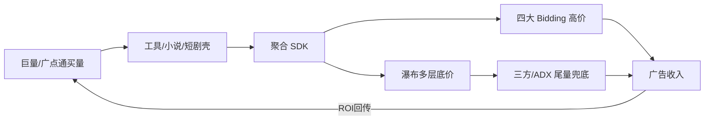

# 广告变现与买量沟通纪要（整理稿）

- 版本 / 日期：v0.1 / 2026-08-03
- 整理范围：本轮对话中与「媒体广告变现、吃尾量、买量策略、实时/离线收入、经营规则落地」相关的全部内容
- 不含：GitHub 推送、Firecrawl 登录排障细节（仅保留与调研手段相关的结论）、Catalog 原型/PRD 其它工作
- 产物索引：见文末「交付物清单」

---

## 1. 你是如何提问的（提问路径复盘）

整体节奏是：**先要现状调研 → 再抠计算与风控 → 再要可落地经营方案 → 最后要可汇报材料**。问题一次比一次更「可执行、可担责」。

### 1.1 提问清单（按时间顺序）

| 序号 | 你的原意（提炼） | 提问特点 |
|------|------------------|----------|
| Q1 | 用 Firecrawl 搜：媒体广告变现现状、最新策略模式；焦点在**变现端**；对象是吃国内四大联盟和三方 SDK **尾量**的小媒体 App；以及它们**买量策略**现在什么样 | 范围大、角色清（变现端）、对象清（吃尾量小媒体）、要「现状 + 策略」 |
| Q2 | Firecrawl 登不上 / VPN 与 Google·GitHub 冲突后，改为「先试免 Key 限流」→「算了继续做调研」 | 工具卡住时果断降级，优先要业务结论 |
| Q3 | 单用户广告收入怎么算？是离线还是实时？ | 从宏观调研切到**核心指标口径** |
| Q4 | 用实时价值做策略会不会模型跑偏、乱触发熔断导致亏损？ | 挑战方案风险，关心**线上安全性** |
| Q5 | 给业内普遍适用且可落地的策略；不要强算法；中小公司数据模型撑不住 | 约束技术边界，明确受众是中小团队 |
| Q6 | 要真实可落地、要汇报；出问题线上崩了会有大问题 | 从「方案」升级到「可担责的作战手册 + 门禁」 |
| Q7 | CSV 改成 Excel，方便用 Excel 打开 | 交付形态对齐汇报工具 |
| Q8 | 把广告相关沟通全部整理成 md，并整理自己是怎么提问的 | 沉淀复盘与知识资产 |

### 1.2 你的提问方式（可复用模式）

1. **先定对象与边界**：变现端 / 小媒体 / 四大联盟+三方尾量 / 买量，而不是空泛「广告行业怎么样」。  
2. **工具服从目标**：登录搞不定就免 Key，继续出调研，不在工具上死磕。  
3. **层层加压**：调研 → 口径 → 风控质疑 → 弱算法可落地 → 汇报级门禁材料。  
4. **反复强调约束**：中小团队、无强算法、防崩盘、可回滚、可签字上线。  
5. **要产物不只要观点**：作战手册、CSV/Excel 模板、参数与门禁表。

### 1.3 当前理解（对话中对齐过的）

- 你关心的不是「头部媒体怎么卖广告」，而是 **腰尾小媒体如何吃联盟/SDK 剩余库存，并用买量滚盘**。  
- 你担心 **实时预估直接驱动策略/熔断** 把盘打崩。  
- 你需要的是 **规则经营 + 可汇报交付物**，不是算法白皮书。

---

## 2. 调研结论摘要：变现端现状

### 2.1 大盘与位置

- 存量博弈：广告变现从堆曝光转向 **eCPM / 填充 / 体验** 一起算。  
- **四大底盘**仍在：穿山甲、优量汇、快手联盟、百青藤（+华为等）。  
- 头部 App 吃高价预算；腰尾小媒体更多吃 **低价层 + 未填请求 + 三方/ADX 补量**（口语「吃尾量」）。  
- 公开网页对「吃尾量」操盘黑话较少；机制上对应 **瀑布底层 + 多 DSP/聚合 ADX 兜底**。

### 2.2 中间层

- 聚合 SDK：GroMore、TopOn/Taku、TradPlus 及各类国内聚合。  
- 主流架构：**Bidding（实时竞价）+ 瀑布流（Waterfall）混合**；纯瀑布在退，但兜底仍靠瀑布/无底价层。

### 2.3 典型产品形态

- 工具类：清理、加速、WiFi、充电等。  
- 内容类：免费小说、短剧壳等。  
- 共同特征：**产品弱、广告场景密、靠买量滚**；激励/开屏/插屏组合变现。

### 2.4 广告位与品类倾向（调研归纳）

| 品类 | 常见组合 |
|------|----------|
| 工具买变 | 开屏 + 插屏 + 激励（开屏 eCPM 往往偏强） |
| 小说/短剧 | 激励解锁 + 插屏 + 信息流 |
| 小游戏 IAA | 激励为主，插屏/开屏补；混变（IAA+IAP）仍是增长点 |

短剧内容侧有平台规则约束（例如穿山甲内容侧：免费短剧侧重激励解锁逻辑等，以平台当期规则为准）。

---

## 3. 最新变现策略模式（调研归纳）

| 模式 | 要点 |
|------|------|
| 聚合接入 | 一站接 5～20 家，降低多 SDK 维护成本 |
| Bidding + 瀑布 | Bidding 吃高价；瀑布多层底价交叉 + 无底价兜底吃剩量 |
| 先填充后抬价 | 填充建议先稳在高位（如 ≥90%），再追 eCPM；只抬底价会打穿利用率 |
| 精细分层 | 同平台多代码位、交叉排序，避免「A 的尾价挡住 B 的头价」 |
| 流量分组 | 新老客、活度不同，瀑布疏密/底价不同 |
| 三方尾量 | 四大之外挂 Sigmob、Mintegral、360、聚合 ADX 等补低价未填 |
| 体验与合规 | 过密插屏伤留存；违规素材影响账号与长期 ROI |

**调研可信度说明：**

- GroMore/Taku 文档、平台 ROI 指南 → 机制较可靠。  
- 聚合商/营销稿中的提升百分比 → 方向可参考，幅度当营销。  
- 「吃尾量」具体操盘细节 → 公开少，部分为行业共识推断。

---

## 4. 买量策略现状（调研归纳）

### 4.1 经营本质

- 简化模型：**单用户广告毛收入 ≈ IPU × eCPM ÷ 1000**。  
- 能否跑通看 **LTV 是否覆盖 CAC**（还要扣奖励、核减、异常量、账期等）。  
- IAA 成熟打法强调 **买量、产品、变现一体化**，不是只优化投放一端。

### 4.2 投放侧常见做法

1. 深度目标：广告变现 ROI / 24h ROI 等（系数过高往往不起量）。  
2. 基建矩阵：账户 × 项目 × 计划 × 素材；新素材计划保持一定占比。  
3. 生态闭环：字节买量 ↔ 穿山甲变现、腾讯买量 ↔ 优量汇，回传与优化更顺。  
4. 波动归因顺序：先查变现（填充/eCPM/场景）→ 再查留存 → 最后查买量。  
5. 小媒体现实：多包并行测；eCPM 掉则砍计划/降价；高广告频次抬 IPU，但过密打留存。

---

## 5. 单用户广告收入：怎么算、实时还是离线

### 5.1 常用指标

| 指标 | 含义 |
|------|------|
| IPU | 单用户广告展示次数 |
| eCPM | 千次展示收入 |
| ARPDAU | 日活人均广告收入 |
| 广告 LTV | 生命周期累计广告收入（D0/D1/D3/D7…） |
| ROI | 广告 LTV（或窗口收入）÷ 获客成本 |

### 5.2 结论：混合，不是二选一

```text
展示回调（近实时）
  → A. 预估账：展示 × Bidding价/预估价（盯盘、弱熔断）
结算/报表（通常 T+1）
  → B. 结算账：真实收入（主决策、财务、改策略）
偏差系数 δ = 结算 ÷ 预估（滚动中位数校准）
校准收入 ≈ 预估 × δ
```

- **控投放、盯盘** → 偏实时预估。  
- **算真赚多少、改主策略** → 偏离线结算。  
- 成熟团队两套并行，定期看预估与结算偏差。

---

## 6. 关于「实时调策略会不会崩盘」的结论

**你的担心成立：** 只用实时预估直接调主策略、直接熔断，容易噪声驱动、误熔断或该停不停。

### 6.1 推荐分层（后续手册已固化）

| 层级 | 时效 | 用途 |
|------|------|------|
| L0 | 分钟级窗口 | 只挡事故：限速/单计划暂停 |
| L1 | 小时级 | 弱干预：降预算、停尾部 |
| L2 | T+1 结算后 | 真正换挡：系数、瀑布、总预算 |

### 6.2 防跑偏要点

- 样本门禁：量不够禁止缩/停/改系数。  
- 迟滞与冷却：防抖开关。  
- 熔断分级：先告警 → 限速 → 单计划暂停；**禁止动不动停整账户**。  
- 预估进风控，结算进主决策。  
- 上线前用历史数据回放误熔断/漏熔断。

---

## 7. 可落地经营方案（弱算法 / 中小团队）

> 完整正文见：`docs/IAA买变经营作战手册-v0.1.md`  
> 此处只保留汇报级要点。

### 7.1 三条铁律

1. 先填满，再抬价。  
2. 实时只刹车，离线才换挡。  
3. 没样本不动刀。

### 7.2 买量状态机（计划级）

冷启动（样本不足只「持」）→ 健康 / 观察 → 收缩（连续 2 日差）→ 关停候选（连续 3 日）→ 关停。  
禁止用小时预估 ROI 直接改出价系数。

### 7.3 变现周节奏

- 每日快检填充、报错、δ。  
- 每周只改 **一个** 主变量；当天买量不大放。  
- 填充未达标的周，只救填充，不抬价。

### 7.4 上线阶段（强制）

只观测 → 半自动（人确认）→ 有限自动（仅 L0 单计划级）。  
门禁未勾完禁止跳级。

### 7.5 明确不做什么

- 不上实时强策略、不强行上复杂用户价值模型。  
- 不为追 eCPM 打穿填充。  
- 不同一天既大改买量又大改瀑布（无法归因）。

---

## 8. 对话中给出的结构图（买变闭环）



---

## 9. 调研手段与限制（本轮）

- 原计划用 Firecrawl 正式账号检索；因登录/代理环境未打通，改用 **免 Key 限流** 完成多轮 search + scrape。  
- 原始检索缓存目录：`bps-catalog-admin-v0.1/.firecrawl/`（本地，一般不入库）。  
- 限制：公开「吃尾量」实操细则少；部分抓取页有营销软文；结论需结合你们业务数据回放后再上线。

---

## 10. 交付物清单

| 产物 | 路径 | 用途 |
|------|------|------|
| 作战手册 | `docs/IAA买变经营作战手册-v0.1.md` | 汇报主文档、纪律条款、L0/L1/L2、门禁 |
| 每日计划作战表 CSV/XLSX | `docs/templates/每日计划作战表-模板.*` | 投放日报 |
| 瀑布流检查清单 CSV/XLSX | `docs/templates/瀑布流配置检查清单-模板.*` | 变现日/周检 |
| 参数与门禁签字表 CSV/XLSX | `docs/templates/参数与上线门禁-签字表.*` | 阈值定稿与上线签字 |
| Excel 合集 | `docs/templates/IAA买变经营表格合集-v0.1.xlsx` | 三表合一，方便汇报 |
| 本沟通纪要 | `docs/广告变现买量沟通纪要-v0.1.md` | 提问路径 + 结论沉淀 |

相关 git 分支（若仍保留）：`cursor/iaa-monetization-ops-playbook`。

---

## 11. 汇报前仍待你们拍板的事项

- [ ] 目标校准 ROI、归因窗口（24h 或 D0）终值  
- [ ] 参数表 P03～P07 等样本/熔断阈值（须近 14 日回放）  
- [ ] L0 是否允许「自动暂停单计划」（建议先半自动）  
- [ ] 主聚合与主投放渠道清单  
- [ ] 值班与 P0 升级人  

---

## 12. 一句话总览

你从「吃尾量小媒体变现+买量现状」问起，逐步收敛到「实时不可作主舵、结算作主决策、弱算法规则经营、可回滚可签字」；本轮最终产物是一套以防崩盘为前提的买变作战手册与 Excel 可填表，而不是算法方案。
